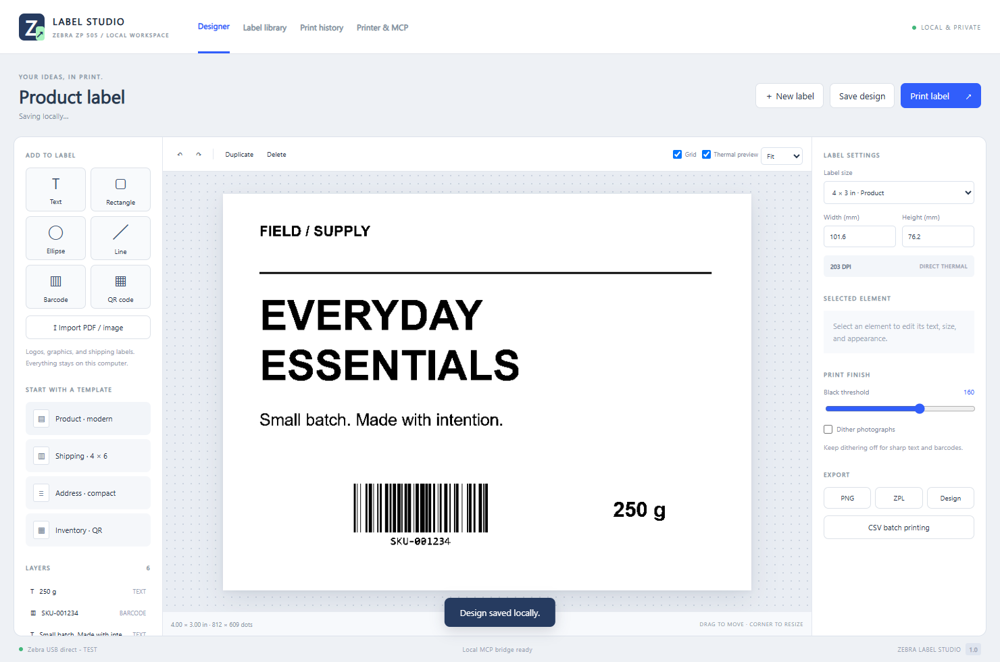

# Zebra Label Studio

A Windows desktop label designer and local MCP print server for the Zebra ZP 505 / ZTC ZP 500 (ZPL).



Physical printing was confirmed on a connected ZP 505: native ZPL text, a small app-rendered graphics label, and a full 4 × 6 diagnostic with a border, barcode, and QR code. See [validation](docs/VALIDATION.md).

## Capabilities

- Visual label designer with editable text, logos/images, rectangles, ellipses, and lines.
- Code 128 barcodes and QR codes.
- Drag, resize, rotate, layer ordering, custom fonts, alignment, fills, and strokes.
- PDF page import, image cropping, monochrome threshold, and photograph dithering.
- Product, shipping-layout, address, and inventory templates.
- Autosave, label library, undo/redo, duplication, keyboard shortcuts, and print history.
- `{{variable}}` fields and CSV batch printing, one label per row.
- PNG, ZPL, and editable JSON exports.
- Direct USB printing through Windows' existing USB printer class driver, or an installed Zebra ZPL print queue.
- Local MCP tools for an assistant to create/edit designs, preview labels, import graphics/PDFs, inspect the printer, and submit print jobs.

See [the complete capability and limit reference](docs/CAPABILITIES.md).

## Build and run

Requires Windows 11 x64, Node.js 24, and npm. In PowerShell:

```powershell
cd source
npm ci
node node_modules/electron/install.js
npm run build
npm test
npm start
```

To produce a portable desktop application:

```powershell
# From source/
node package.cjs
```

This creates `desktop/` at the repository root. Double-click `Start-Label-Studio.cmd`. The executable includes its runtime, so the packaged app does not require a separate Node installation. Keep its runtime files together. Saved labels and print history use a separate root-level `data/` folder.

The packager refuses to overwrite an existing output folder. Pass a fresh directory if needed: `node package.cjs ../desktop-next`.

## Connect the printer

1. Connect and power on the Zebra with direct thermal stock loaded.
2. Open **Printer & MCP** and refresh the printer list.
3. Select **Zebra USB direct**, or your installed **Zebra ZP500 (ZPL)** Windows queue.
4. Choose the label dimensions matching your stock and test the output.

The direct route uses Microsoft's `usbprint.sys`; it does not install WinUSB or change firmware. It prints from this app and does not create a universal Windows printer for other applications. For printing from other apps' print dialogs, use the official carrier driver.

The original FedEx driver ZIP links redirected to a support page during development. No third-party OEM driver installer or firmware is redistributed in this repository. Official references are listed below.

## MCP connection

After packaging, run `Connect-Codex.ps1` from the repository root to add the local server to Codex, then restart Codex. The app's **Printer & MCP** screen can generate configuration with exact paths for other local MCP clients. `mcp-client.example.json` shows the structure.

The stdio adapter starts the local app when necessary and talks to an authenticated service bound to `127.0.0.1`. No cloud rendering or AI API key is required by Label Studio; the MCP client supplies the assistant.

Example request:

> Create an editable 4 × 3 inch product label with a bold title, my logo, a Code 128 SKU, and a QR code. Show me a preview before printing.

All design coordinates and font sizes use millimetres; output resolution is 203 dpi. See [MCP tools and design schema](docs/CAPABILITIES.md#mcp-tools).

## Limits

- Windows implementation; macOS/Linux printing is not implemented.
- Direct thermal monochrome output, maximum 104 mm print width.
- PDF imports place one selected page at a time; cropping is manual.
- CSV batches are limited to 100 rows; copies to 100 per job.
- No postage purchasing, carrier-rate integration, firmware upgrade, or universal Windows driver.
- The shipping template is a layout example, not valid purchased postage.
- A successful USB write or spooler submission does not prove physical print completion. Check the output and scan-test barcodes before operational use.

## Repository layout

- `source/`: Electron app, rendering engine, Windows print helpers, MCP adapter, and core tests.
- `examples/`: editable label templates and sample CSV data.
- `docs/`: capability reference, validation, and a generic designer screenshot.
- `THIRD-PARTY-NOTICES.txt`: bundled dependency notices. Electron/Chromium license files are retained by the packager.

This is an independent utility, not a Zebra or FedEx product. Keep the printer's factory firmware.

## Primary references

- [Zebra ZP505 specifications](https://www.zebra.com/content/dam/support-dam/en/documentation/unrestricted/presentation/ZP505_datasheet.pdf)
- [Zebra model support and firmware notice](https://www.zebra.com/us/en/support-downloads/printers/desktop/zp500.html)
- [FedEx Windows printer resources](https://www.fedex.com/en-us/shipping/ship-manager/software.html)
- [Microsoft USB printer class driver](https://learn.microsoft.com/en-us/windows-hardware/drivers/print/printer-connected-to-a-usb-port)
- [Microsoft RAW printing API](https://learn.microsoft.com/en-us/windows/win32/printdocs/writeprinter)
- [MCP stdio specification](https://modelcontextprotocol.io/specification/2025-11-25/basic/transports)
